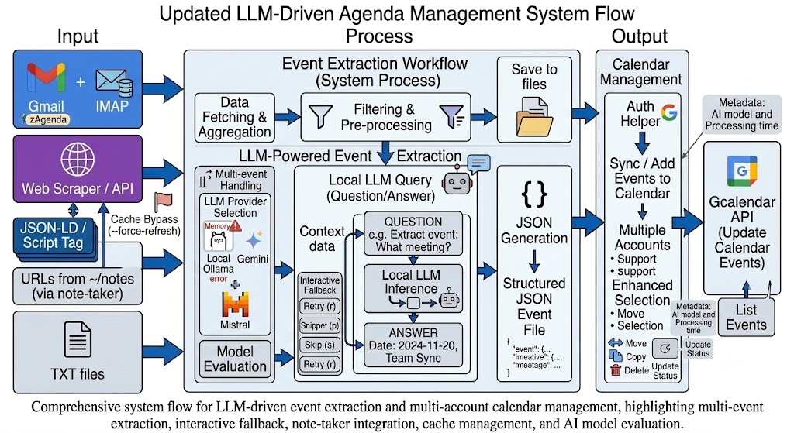

# manage-agenda

[](https://github.com/fernand0/manage-agenda/releases)
[](https://github.com/fernand0/manage-agenda/actions/workflows/test.yml)
[](https://github.com/fernand0/manage-agenda/blob/main/LICENSE)

A tool for adding entries to your Google Calendar from email messages, web pages, text files, and images using Large Language Models (LLMs) to extract event information.



## Features

- **Automatically extract event information from:**
  - **Gmail** messages (filtered by label/tag)
  - **IMAP** email accounts
  - **Web pages** and URLs, including structured data (JSON-LD, script tags). Supports batch-processing URLs from `~/notes` via [note-taker](https://github.com/fernand0/another-note-taking-app) integration
  - **Text files** stored locally
  - **Images** (OCR & multimodal vision extraction for event flyers, posters, and screenshots)
  - Extraction features available across sources:
    - **Multi-event extraction**: Extract multiple events from a single source
    - **Smart date recognition**: Advanced date parsing for complex scheduling scenarios
    - **Cache bypass**: Force refresh web content to bypass cache with `--force-refresh`
- **LLM-powered event extraction:**
  - Supports **Ollama** (local models), **Gemini**, and **Mistral**
  - **Multimodal vision support**: Extract text and event details directly from images
  - **Model evaluation**: Compare multiple Ollama models side-by-side with the `llm evaluate` command
  - **Interactive fallback**: When extraction fails, retry, provide a text snippet, or skip
  - **Retry option**: Retry LLM processing during date confirmation with `r`
  - **Memory error handling**: Automatic fallback when models require more memory
  - **AI model metadata**: Calendar events include metadata about which model processed them
- **Calendar management:**
  - **Sync**: Seamlessly add events to your Google Calendar
  - **Flexible output**: Add events directly to Google Calendar or save as JSON files
  - **Multiple accounts**: Support for multiple email and calendar accounts
  - **Event operations**: Clean, copy, move, delete, and update calendar events
  - **Enhanced event selection**: Select events by number, keyword matching, or `all`
- **Auth Helper**: The `auth` command guides you through Google API credential setup

## Installation

### Prerequisites
- Python 3.10+
- [uv](https://github.com/astral-sh/uv) (recommended) or pip
- API keys for LLM providers (optional, for cloud models like Gemini or Mistral)
- Ollama running locally (optional, for local models)

### Quick Setup
```bash
git clone git@github.com:fernand0/manage-agenda.git
cd manage-agenda
uv sync  # or pip install -e .
```
> [!NOTE]
> Dependencies including [socialModules](https://github.com/fernand0/socialModules) and [note-taker](https://github.com/fernand0/another-note-taking-app) are installed automatically.

### Install Browser (for web page processing)
```bash
# Install the default browser engine (Firefox) for Playwright
uv run manage-agenda install

# Or install a different browser
uv run manage-agenda install -b chromium
```

### Configuration
1. **Environment Variables**: Copy `.env.example` to `.env` and fill in your values:
   ```bash
   cp .env.example .env
   ```
   Set your preferred `DEFAULT_TIMEZONE` and API keys (see [Environment Variables](#environment-variables)).
2. **Google API / Account Setup**: Run the interactive authentication helper to check and configure your Google credentials:
   ```bash
   uv run manage-agenda auth -i
   ```
3. **Email and Calendar Rules**: Accounts are managed via [socialModules](https://github.com/fernand0/socialModules) stored under `~/.mySocial/config`.

---

## Quickstart

Extract events interactively from emails, web pages, text, or images in 3 steps:

```bash
# 1. Run in interactive mode
uv run manage-agenda add -i

# 2. Select model (Local Ollama / Gemini / Mistral) and choose data source
# 3. Review extracted details and confirm adding to Google Calendar
```

---

## Usage

### Basic Usage
```bash
# Show help
uv run manage-agenda --help

# Add events (interactive mode - choose email, web, text, or image source)
uv run manage-agenda add -i

# Add events from email (non-interactive, uses default LLM and configured email)
uv run manage-agenda add

# Add events with a specific LLM
uv run manage-agenda add -a gemini
uv run manage-agenda add -a mistral

# Add events from a specific source
uv run manage-agenda add -s web
uv run manage-agenda add -s imap
uv run manage-agenda add -s text
uv run manage-agenda add -s image

# Add events with force refresh (bypass cache for web pages)
uv run manage-agenda add -i -f

# Save events to JSON files instead of adding to calendar
uv run manage-agenda add -o file

# Add events to a specific calendar
uv run manage-agenda add -d "My Calendar"

# Verbose output for debugging
uv run manage-agenda -v add -i

# Calendar management
uv run manage-agenda clean
uv run manage-agenda copy
uv run manage-agenda move
uv run manage-agenda delete
uv run manage-agenda update-status

# List events or emails
uv run manage-agenda gcalendar -i
uv run manage-agenda gmail -i

# Evaluate Ollama models
uv run manage-agenda llm evaluate

# Check/setup Google API authentication
uv run manage-agenda auth -i

# Install Playwright browser
uv run manage-agenda install
```

### Interactive Event Processing
When running in interactive mode (`-i`):

1. **Select an AI model**: Local (Ollama), Mistral, or Gemini (`l`/`m`/`g`).
2. **Choose a specific model** from the available options.
3. **Select a source**: Email account (Gmail/IMAP), Web, Text files, or Images.
4. **Source input**:
   - **Web**: Enter URLs directly, or press Enter to extract URLs from `~/notes` (via note-taker).
   - **Text**: Provide file paths or read from `~/Documents/txt/`.
   - **Image**: Provide image paths or process from `~/Documents/images/`.
   - **Email**: Fetch messages tagged with the configured label (default: `zAgenda`).
5. Content is extracted and processed by the AI for event parsing.
6. If multiple events are found, each is processed individually.
7. Select destination Google Calendar.
8. Review and confirm event details.
9. **Confirm dates**:
   - `s`: Dates are correct (yes)
   - `n`: Manually enter new dates
   - `r`: Retry - ask the LLM again with the same prompt
   - `Y`: Modify year, `M`: month, `D`: day, `h`: hour, `m`: minute
10. Optionally remove the label from processed emails or delete processed notes.

### Interactive Fallback
When LLM extraction fails, interactive mode offers fallback options:
- `r`: Retry with the same content
- `p`: Provide a relevant text snippet for the LLM to focus on
- `s`: Skip the item

---

## Commands

### `add` - Add Events
Add entries to your calendar from email, web, text file, or image sources. In interactive mode, presents a unified source selection menu.

#### Options
- `-i, --interactive`: Running in interactive mode
- `-a, --ai`: Select LLM provider (default: `ollama`). Options: `ollama`, `gemini`, `mistral`
- `-s, --source`: Select data source. Options: `email`, `gmail`, `imap`, `web`, `text`, `image`
- `-f, --force-refresh`: Force refresh web content to bypass cache
- `-d, --destination`: Select destination calendar by name
- `-o, --output`: Output destination (default: `calendar`). Options: `calendar`, `file`

### `llm` - LLM Operations
Group command for LLM-related operations.

#### `llm evaluate`
Evaluate multiple Ollama models by running the same prompt through each and comparing responses and timing. Optionally accepts a prompt argument; if not provided, allows selecting an email to use as prompt.

##### Options
- `-t, --type`: Evaluation input type (default: `txt`). Options: `email`, `web`, `txt`, `image`
- `-o, --output`: Output destination (default: `file`). Options: `calendar`, `file`
- `PROMPT` (optional argument): Text prompt to evaluate directly

### Calendar Management Commands

> **Event Selection** (applies to `clean`, `copy`, `delete`, `move`, `update-status`):
> - Enter comma-separated numbers to select specific events (e.g., `0,2,4`)
> - Enter `all` to select all events
> - Enter text to match events containing that text (e.g., `meeting` selects all events with "meeting" in the title)

#### `clean` - Clean Calendar Entries
Combined workflow allowing users to select between copying events to another calendar or deleting them, with filtering capabilities.

- `-i, --interactive`: Running in interactive mode
- `-s, --source`: Select source calendar
- `-d, --destination`: Select destination calendar
- `-t, --text`: Filter events by title text
- `-D, --start-date`: First date to search events from (e.g. `'2024-01-01'`). Defaults to today.

#### `copy` - Copy Events
Copy events from one calendar to another with filtering capabilities.

- `-i, --interactive`: Running in interactive mode
- `-s, --source`: Select source calendar
- `-d, --destination`: Select destination calendar
- `-t, --text`: Filter events by title text
- `-D, --start-date`: First date to search events from (e.g. `'2024-01-01'`). Defaults to today.

#### `delete` - Delete Events
Delete events from a calendar with text-based filtering.

- `-i, --interactive`: Running in interactive mode
- `-s, --source`: Select source calendar
- `-t, --text`: Filter events by title text
- `-D, --start-date`: First date to search events from (e.g. `'2024-01-01'`). Defaults to today.

#### `move` - Move Events
Move events between calendars (equivalent to copy + delete).

- `-i, --interactive`: Running in interactive mode
- `-s, --source`: Select source calendar
- `-d, --destination`: Select destination calendar
- `-t, --text`: Filter events by title text
- `-D, --start-date`: First date to search events from (e.g. `'2024-01-01'`). Defaults to today.

#### `update-status` - Update Event Status
Update the transparency of calendar events from "opaque" (busy) to "transparent" (available), making them appear as free time.

- `-i, --interactive`: Running in interactive mode
- `-s, --source`: Select source calendar
- `-t, --text`: Filter events by title text

### Account & Inspection Commands

#### `gcalendar` - List Calendar Events
Display events from your Google Calendar.
- `-i, --interactive`: Running in interactive mode

#### `gmail` - List Emails
Display messages from Gmail matching the configured tag (`DEFAULT_EMAIL_TAG`, default `zAgenda`).
- `-i, --interactive`: Running in interactive mode

#### `auth` - Authentication Setup
Check Google API authentication status and guide through credential setup.
- `-i, --interactive`: Running in interactive mode

#### `install` - Install Browser
Install the Playwright browser engine needed for web scraping.
- `-b, --browser`: Which browser to install (default: `firefox`). Options: `chromium`, `firefox`, `webkit`, `chrome`, `chrome-beta`

---

## Supported LLM Providers

| Provider | Type | Capabilities | Requirements |
|---|---|---|---|
| **Ollama** (default) | Local | Text, Multimodal Vision, Memory Fallback | Running Ollama instance (`OLLAMA_HOST`) |
| **Google Gemini** | Cloud API | Text, Multimodal Vision, Fast Extraction | `GEMINI_API_KEY` |
| **Mistral** | Cloud API | Text, Multimodal Vision | `MISTRAL_API_KEY` |

---

## Environment Variables

Configuration can be set via environment variables or a `.env` file. See [`.env.example`](.env.example) for a template.

| Variable | Description | Default |
|---|---|---|
| `GEMINI_API_KEY` | API key for Google Gemini | — |
| `MISTRAL_API_KEY` | API key for Mistral AI | — |
| `OLLAMA_HOST` | Ollama server URL | `http://localhost:11434` |
| `OLLAMA_DEFAULT_MODEL` | Default Ollama model | `llama3.1` |
| `DEFAULT_TIMEZONE` | IANA timezone for events | `Europe/Berlin` |
| `LOG_LEVEL` | Logging level (`DEBUG`, `INFO`, `WARNING`, `ERROR`) | `INFO` |
| `LOG_FILE` | Path to log file | `~/.local/share/manage-agenda/manage_agenda.log` |
| `DEFAULT_EMAIL_TAG` | Gmail label/tag for event emails | `zAgenda` |
| `MSG_TXT_DIR` | Directory for local text files | `~/Documents/txt/` |
| `MSG_IMG_DIR` | Directory for local image files | `~/Documents/images/` |

---

## Troubleshooting

### Google OAuth Credentials
- If you see `No services configured` or `Credentials not found`, run:
  ```bash
  uv run manage-agenda auth -i
  ```
  Follow the on-screen instructions to authorize access and place `credentials.json` in `~/.config/manage-agenda/`.

### Web Extraction / Playwright Issues
- If web processing fails due to missing browsers, install the browser engine:
  ```bash
  uv run manage-agenda install
  ```

### Ollama Connection Errors
- Ensure the Ollama daemon is running (`ollama serve` or system service) and accessible at `OLLAMA_HOST` (default `http://localhost:11434`).
- Check that the model specified in `OLLAMA_DEFAULT_MODEL` is pulled:
  ```bash
  ollama pull llama3.1
  ```

---

## Development

### Setting Up for Development
```bash
# Clone the repository
git clone git@github.com:fernand0/manage-agenda.git
cd manage-agenda

# Create virtual environment and install dependencies
uv sync --extra dev
# Or with pip:
python -m venv venv
source venv/bin/activate  # On Windows: venv\Scripts\activate
pip install -e '.[dev]'
```

### Running Tests
```bash
python -m pytest
```

Run the LLM response regression fixtures only:
```bash
python -m pytest tests/test_llm_responses.py
```

### Contributing
1. Fork the repository
2. Create a feature branch
3. Make your changes
4. Add tests for new functionality
5. Submit a pull request

---

## License

Apache 2.0 - See [LICENSE](LICENSE) file for details.
